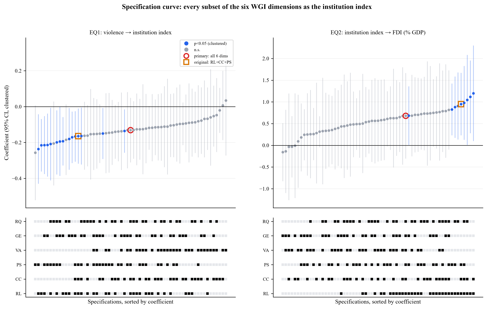
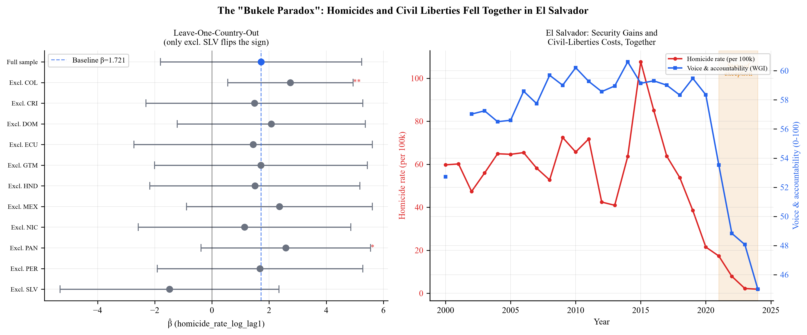
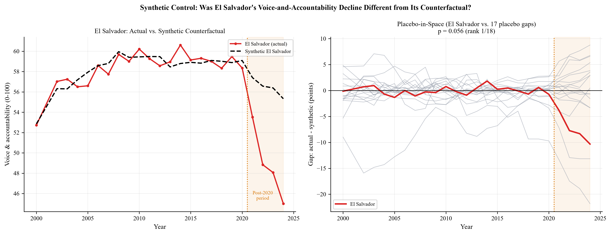
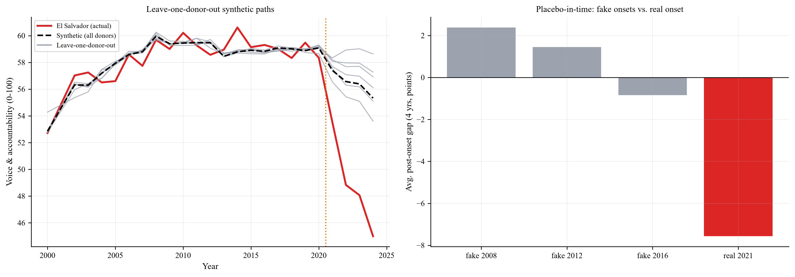
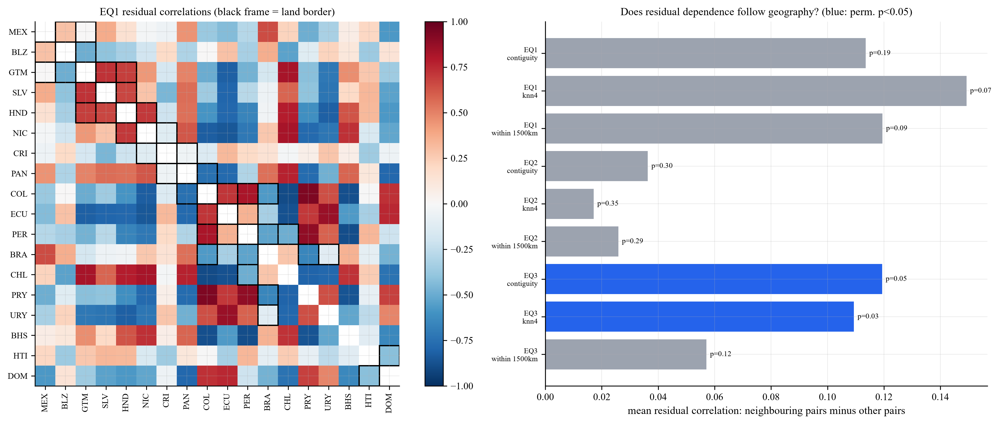
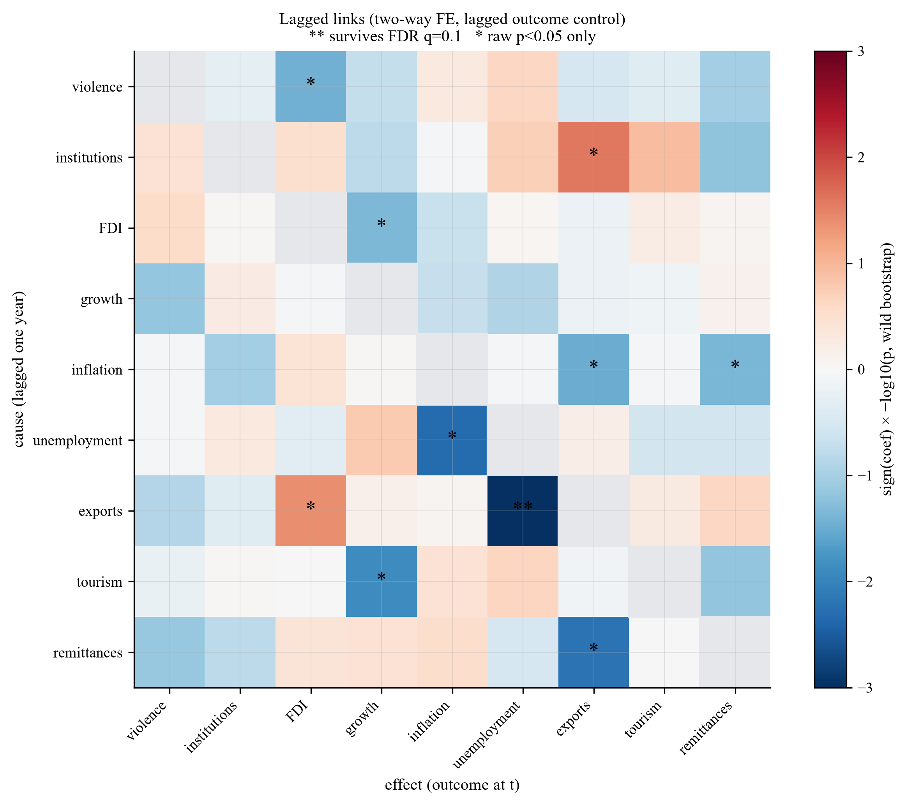
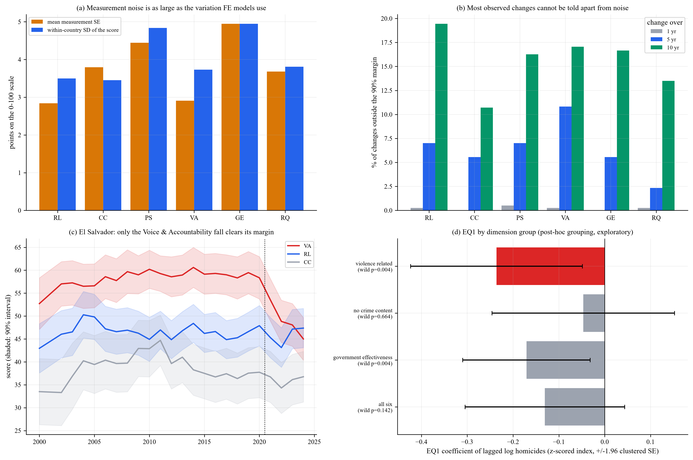
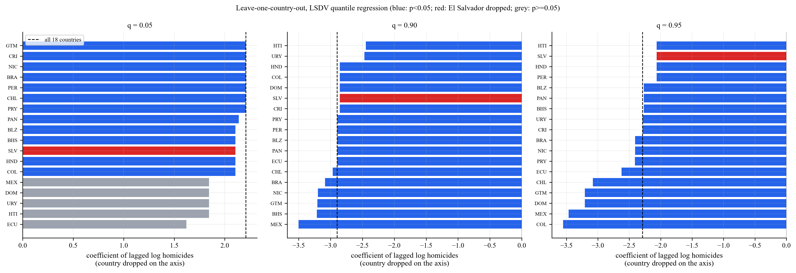

# Violencia, Instituciones y Crecimiento en América Latina y el Caribe

Este repositorio implementa un flujo de trabajo empírico para estudiar cómo el crimen violento afecta la calidad institucional y, a través de ese canal, el crecimiento económico. El proyecto combina un panel de datos econométrico estructurado con técnicas de aprendizaje automático para examinarse si la relación entre la exposición a homicidios y el crecimiento es directa o está mediada por la calidad institucional y la inversión extranjera directa (IED). El análisis se centra en un panel de 18 países de América Latina y el Caribe —los 11 originales (Centroamérica, Colombia, República Dominicana, México, Ecuador y Perú) más Bahamas, Belice, Brasil, Chile, Haití, Paraguay y Uruguay (agregados en octubre de 2026 bajo una regla de cobertura fijada de antemano; ver Segunda Extensión del Panel más abajo)— durante el período 2000-2024 (447 observaciones país-año).

## Pregunta de Investigación

¿Cómo afecta la violencia, medida por las tasas de homicidio, a la calidad institucional y al desempeño económico posterior, y está la relación entre el crimen y el crecimiento mediada por las instituciones y la IED?

## Metodología

El proyecto utiliza un diseño de panel longitudinal con efectos fijos por país y año. La especificación de referencia es un MCO agrupado, seguido de modelos de efectos fijos bidireccionales que absorben la heterogeneidad invariante en el tiempo por país y los choques comunes. La inferencia se informa con errores estándar agrupados convencionales y con alternativas más conservadoras, incluyendo errores estándar de Driscoll-Kraay para considerar la dependencia transversal, un estimador CR2 (Bell-McCaffrey) con grados de libertad de Satterthwaite, e inferencia de bootstrap de grupo silvestre (wild cluster bootstrap) para paneles con pocos grupos. Dado que la cadena de tres ecuaciones (violencia → instituciones → IED → crecimiento) se estima como modelos independientes para evitar un problema de regresores generados, el mecanismo hipotetizado se pone a prueba adicionalmente como sistema: un bootstrap por clúster de país del producto de los tres coeficientes de la cadena ofrece una prueba formal del efecto indirecto, en lugar de apoyarse solo en la significancia de cada eslabón por separado. Las comprobaciones de robustez incluyen exclusión de cada país (Leave-One-Country-Out), estructuras de rezago alternativas para los tres eslabones (no solo violencia→instituciones), una verificación de control post-tratamiento, tendencias lineales específicas por país y una prueba de raíz unitaria de panel (Fisher-ADF). Además, se utiliza un análisis de componentes principales (PCA) para construir un índice institucional de robustez a partir de los Indicadores de Gobernanza Mundial (WGI), y se emplean métodos de aprendizaje automático como una capa de triangulación exploratoria en lugar de un sustituto para la estimación causal, con una reconstrucción del índice institucional libre de fuga de datos (fold-safe) bajo validación cruzada Leave-One-Country-Out. Finalmente, un hallazgo exploratorio de regresión cuantílica —que la violencia limita la cola superior del crecimiento del PIB sin desplazar su mediana— se re-estima como un modelo bayesiano jerárquico (MCMC, verosimilitud Asimétrica de Laplace) con partial pooling entre países, reportado con incertidumbre posterior completa en vez de errores estándar asintóticos de regresión cuantílica.

El flujo de trabajo se ejecuta en dieciséis etapas:
1.  **Carga de datos**: lee un conjunto de datos de panel limpio que contiene observaciones país-año.
2.  **Limpieza y ETL**: valida los datos, evalúa los valores perdidos y estandariza y combina las variables institucionales en un índice.
3.  **Ingeniería de características**: enriquece el panel con tendencias temporales, variables de violencia rezagadas y medidas institucionales derivadas.
4.  **Construcción de PCA**: crea un índice institucional de robustez utilizando PCA en los indicadores de gobernanza.
5.  **Estimación econométrica**: estima modelos de efectos fijos bidireccionales para las relaciones violencia-instituciones, instituciones-IED y IED+instituciones-crecimiento, cada una reestimada también bajo una alternativa con rezago de un año.
6.  **Triangulación con aprendizaje automático**: entrena modelos de bosque aleatorio y aumento de gradiente para una comparación exploratoria con las estimaciones econométricas, usando validación cruzada Leave-One-Country-Out con un índice institucional libre de fuga de datos.
7.  **Validación**: ejecuta diagnósticos, inferencia de bootstrap (incluyendo un bootstrap por clúster del efecto indirecto de la cadena completa de mediación) y comprobaciones de robustez para evaluar la sensibilidad a observaciones influyentes, opciones de rezago, conjuntos de controles, tendencias específicas por país, no estacionariedad y especificación del modelo.
8.  **Cointegración de panel y corrección de errores**: para los pares de variables no estacionarias detectadas en la etapa 7 (homicidios, instituciones, PIB per cápita), un test de dos pasos Engle-Granger/Kao verifica si comparten una relación de equilibrio de largo plazo genuina antes de estimar un modelo de corrección de errores; si no la comparten, esto se reporta como un hallazgo en sí mismo en vez de asumirse silenciosamente.
9.  **Growth-Ceiling-at-Risk (MCMC bayesiano)**: una regresión cuantílica jerárquica bayesiana (verosimilitud Asimétrica de Laplace, partial pooling entre países) re-estima un hallazgo exploratorio según el cual la violencia limita la cola superior del crecimiento del PIB sin afectar su mediana, sustituyendo las variables dummy por país (LSDV) y la inferencia asintótica de regresión cuantílica por regularización de partial pooling e incertidumbre posterior completa.
10. **Control sintético**: un "El Salvador sintético" construido con los demás países estima la trayectoria contrafactual de voz y rendición de cuentas sin el giro político-institucional posterior a 2020, con inferencia por placebo-en-el-espacio y chequeos de robustez (excluir cada donante, placebo en el tiempo, inicio en 2022).
11. **Diagnóstico de heterocedasticidad condicional**: test ARCH-LM de Engle por país, para comprobar si un modelo de volatilidad tipo GARCH tendría algo que estimar.
12. **Curva de especificaciones**: EQ1 y EQ2 se re-estiman para cada uno de los 63 subconjuntos de las seis dimensiones WGI usado como índice institucional, mostrando cuánto dependen las conclusiones de esa elección.
13. **Dependencia espacial**: CD de Pesaran e I de Moran por permutación sobre los residuos, modelos de contagio (SLX) con matrices de pesos espaciales, y verificación de que los donantes del control sintético no están contaminados por los vecinos de El Salvador.
14. **Barrido de eslabones causales**: los 72 eslabones ordenados entre nueve variables del panel, rezagados y con el rezago de la dependiente como control, con control de falsos descubrimientos y calibración por placebo, para ver qué eslabones y cadenas distintos de los del artículo tienen evidencia.
15. **Diagnósticos de medición del WGI**: los intervalos de confianza al 90% del propio WGI miden cuánto del puntaje institucional es ruido, qué cambios se distinguen de él, cuánto podría atenuarse el coeficiente del índice, dónde vive el vínculo violencia → instituciones y la sensibilidad a país-año con pocas fuentes.
16. **Robustez del techo de crecimiento**: re-ajustes dejando un país fuera de la regresión cuantílica y del modelo bayesiano sin El Salvador.

## Revisión Metodológica (Septiembre 2026)

Una revisión metodológica del pipeline —realizada de cara a una eventual publicación en arXiv o presentación universitaria— identificó y corrigió varios problemas comunes en estudios de panel con N pequeño. El detalle técnico completo vive en los docstrings de cada módulo y en el historial de commits (`79a37a6` a `7563671`):

1. **La sensibilidad al estimador de errores estándar ahora se reporta en vez de citar el número más favorable.** El coeficiente instituciones → IED (EQ2) parece "marginalmente significativo" (p ≈ 0.055) solo bajo errores clusterizados convencionales —el menos conservador de los cuatro estimadores que calcula el pipeline, y conocido por sobre-rechazar con G=8 clústeres. Bajo Driscoll-Kraay (p ≈ 0.12) y CR2 Bell-McCaffrey (p ≈ 0.20) no es significativo al 10%; el bootstrap de clúster silvestre da p ≈ 0.06. Ver `tables/se_comparison.tex` y la Sección 11 del reporte PDF.
2. **La cadena de transmisión completa ahora se prueba formalmente, no solo se narra.** El Módulo 04 hace bootstrap del producto de los tres coeficientes de la cadena (β₁·γ₁·δ₁) remuestreando países. Estimación puntual: −0.017, IC 95% [−0.079, 0.065], p = 0.62 — la cadena como sistema no es distinguible de cero, aunque el signo de cada eslabón coincida con la teoría.
3. **La estructura de rezagos ahora se prueba en EQ2 y EQ3, no solo en EQ1.** El modelo teórico argumenta que instituciones y crecimiento se ajustan más lento que la violencia, pero las especificaciones primarias de EQ2/EQ3 usaban regresores contemporáneos. Reestimar con rezagos de un año (Módulo 05) invierte el signo de EQ3 (+0.137 contemporáneo vs. −0.121 rezagado).
4. **Se agregó una verificación de control post-tratamiento ("bad control").** `gdp_per_capita_log` es plausiblemente posterior a instituciones/IED, no un confusor exógeno; excluirlo mueve el coeficiente de EQ2 de 0.900 (p=0.055) a 0.739 (p=0.128).
5. **Se agregaron tendencias lineales específicas por país y una prueba de raíz unitaria de panel (Fisher-ADF / Maddala-Wu).** Los efectos fijos bidireccionales no eliminan tendencias específicas por país, y `homicide_rate_log`, `inst_avg` y `gdp_per_capita_log` no logran rechazar raíz unitaria en este panel de 25 años — consistente con que EQ1 (violencia → instituciones) sea el eslabón menos estable en todas las comprobaciones del pipeline.
6. **La validación cruzada Leave-One-Country-Out ya no filtra el país excluido hacia el índice institucional.** `inst_avg` se reconstruye dentro de cada pliegue usando solo las constantes de escala de los países de entrenamiento.
7. **Se corrigió un bug silencioso en la tabla de convergencia FE-ML** — siempre imprimía "?" por una búsqueda incorrecta de clave JSON para los coeficientes de EQ3.

## Corrección de Origen de Datos (Septiembre 2026)

Una auditoría posterior de la cadena de extracción (`data_extraction/`, `archive/legacy_scripts/`) —motivada por la sospecha de que mezclar escalas distintas causaba problemas— encontró que las escalas en sí no eran el problema (mezclar puntajes de gobernanza 0-100, % del PIB y logs en la misma regresión no sesga FE/OLS ni el ML basado en árboles), pero sí encontró 4 bugs reales de datos:

1. **`homicide_rate` se winsorizaba silenciosamente al percentil 1-99** antes del log. Con 179 observaciones, los 4 puntos recortados eran, los 4, El Salvador: su pico de violencia 2015/2016 (107.6→83.6, 85.1→83.6) y sus mínimos post-reforma 2023/2024 (2.24→5.43, 1.90→5.43) — exactamente el cambio abrupto que motiva esta investigación, aplanado antes de llegar a EQ1. Eliminado.
2. **`trade_percent_gdp` estaba 100% vacío** en todas las observaciones, por un bug que sumaba `imports_percent_gdp`, columna que nunca se extrajo. Esto explica por qué "Extended controls" siempre fallaba en el Módulo 05. Corregido agregando el indicador faltante del Banco Mundial.
3. **`gdp_per_capita` mezclaba dólares nominales y reales para Guatemala específicamente** — un script de relleno de huecos usaba el indicador equivocado para ese país. Corregido para usar el mismo indicador que los otros 7 países.
4. **El único script de extracción de WGI en vivo pedía la escala incorrecta** (el "estimate" en vez del "score" 0-100 que documenta todo el pipeline) — código muerto, ya que la fuente real era un archivo descargado manualmente y nunca versionado. Corregido, cerrando el hueco de reproducibilidad.

El panel ahora está balanceado a nivel país-año (200 filas = 8×25, antes 179). Al re-correr el pipeline completo con los datos corregidos, las conclusiones de EQ1, EQ3 y el test de mediación no cambian, pero **EQ2 (instituciones→IED) se vuelve mucho más robusto**: p=0.055/0.116/0.202/0.062 (clusterizado/Driscoll-Kraay/CR2/bootstrap) → **p=0.007/0.085/0.126/0.012**.

## Extensión del Panel (Septiembre 2026)

*(Registro histórico del paso de 8 a 11 países. El panel se amplió después a 18 países y el patrón de significancia cambió; ver la Segunda Extensión del Panel más abajo para los resultados actuales.)*

Todas las advertencias sobre G=8 en este documento especulaban que el número pequeño de países era la restricción estadística que más pesaba en los resultados. Esa hipótesis ya se puso a prueba directamente: se agregaron México, Ecuador y Perú al panel (11 países, 274 filas país-año, antes 200), incluyendo específicamente a México por su peso regional en dinámicas de seguridad (violencia asociada al narcotráfico). Los mismos scripts de extracción se reutilizaron sin cambios de lógica —solo creció la lista de países— confirmando que el pipeline de datos corregido en la fase anterior generaliza bien.

El efecto sobre los resultados fue considerable, en la dirección que predecían las advertencias de G pequeño:

| | EQ1 (violencia→instituciones) | EQ2 (instituciones→IED) | EQ3 (IED→crecimiento) |
|---|---|---|---|
| p (clusterizado), 8→11 países | 0.352 → **0.093*** | 0.007 → **0.0005*** | 0.306 → **0.010*** |
| p (Driscoll-Kraay) | 0.417 → **0.010*** | 0.085 → **0.003*** | — |
| p (bootstrap de clúster silvestre) | 0.290 → **0.085*** | 0.012 → **0.002*** | 0.450 → 0.108 |

El bootstrap de mediación del efecto indirecto conjunto pasó de una estimación puntual de -0.0075 (IC 95% [−0.069, 0.051], p=0.65) a -0.031 (IC 95% [−0.137, 0.015], p=0.144) —el IC todavía incluye cero, pero la cadena está bastante más cerca de la significancia formal como sistema que con N=8. El test de cointegración del Módulo 07 también cambió cualitativamente: el par homicidios/PIB per cápita (T3) ahora muestra evidencia de cointegración (Fisher-ADF sobre residuos, p=0.011) donde antes no la había, y el modelo de corrección de errores resultante encuentra una velocidad de ajuste significativa (phi=-0.109, p<0.01): el PIB per cápita corrige cerca del 11% de cualquier desviación de su relación de largo plazo con la violencia cada año — el primer resultado dinámico (no solo estático) de este proyecto.

## Segunda Extensión del Panel: de 11 a 18 Países (Octubre 2026)

La extensión de septiembre (8 → 11 países) movió mucho los resultados, y todas las advertencias de G pequeño de este documento señalaban el número de países como la restricción que más pesaba. Por eso el panel se amplió otra vez, ahora bajo una regla de cobertura fijada *antes* de mirar cualquier estimación. Se consultaron las APIs del Banco Mundial para las 42 economías de la región de América Latina y el Caribe, y se agregó un país si tenía: tasa de homicidios en al menos 15 de los 25 años; cada una de las seis dimensiones WGI en al menos 20 de los 24 años disponibles; cada una de seis series centrales de WDI (crecimiento del PIB, PIB per cápita, IED, inflación, exportaciones, población) en al menos 20 años; y desempleo en al menos 15 años. Los 11 países originales se conservaron sin importar la regla, por continuidad con todo lo reportado antes (Perú no pasaría el umbral de homicidios, con 11 años observados). Siete países la cumplieron: **Bahamas, Belice, Brasil, Chile, Haití, Paraguay y Uruguay**, lo que da **18 países y 447 filas país-año**. El resto no la cumple porque WDI no publica una serie requerida —por ejemplo exportaciones de Jamaica y Trinidad y Tobago, inflación de Argentina y Venezuela, y tasas de homicidio de Bolivia (9 años observados).

En el camino se encontraron y corrigieron dos problemas de datos. (i) Los scripts de extracción ignoraban en silencio los timeouts transitorios de la API, lo que en un primer intento dejó sin las series de importaciones de Colombia y Nicaragua ni la de desempleo de Haití; ahora los scripts reintentan, y los datos de los 11 países originales se compararon celda por celda con el panel anterior (las únicas diferencias son la corrección siguiente). (ii) La tasa de homicidios de El Salvador en 2023 era 2.24, un valor sin fuente rastreable; la cifra oficial (Fiscalía General) es 2.4 (154 homicidios), y el valor de 2024 (1.9) ya era correcto. La corrección es estadísticamente irrelevante (coeficiente de EQ1 −0.1295 con 2.24 frente a −0.1305 con 2.4).

**Los eslabones principales no sobreviven al panel más grande:**

| | EQ1 (violencia→instituciones) | EQ2 (instituciones→IED) | EQ3 (IED→crecimiento) |
|---|---|---|---|
| 11 países originales: coeficiente (p clusterizado) | −0.059 (0.485) | 0.882 (**0.030**) | 0.208 (**0.009**) |
| Los 18 países: coeficiente (p clusterizado) | −0.131 (0.155) | 0.680 (**0.176**) | 0.032 (**0.696**) |
| 18 países: p Driscoll-Kraay | **0.015** | 0.101 | 0.632 |
| 18 países: p CR2 Bell-McCaffrey | 0.307 | 0.232 | 0.714 |
| 18 países: p bootstrap de clúster silvestre | 0.149 | 0.199 | 0.715 |
| N (país-año), 11 → 18 | 231 → 379 | 264 → 432 | 264 → 432 |

*(Las dos filas de coeficientes usan la misma definición del índice y la misma versión de los datos: `inst_avg` se estandariza con el panel completo, así que su escala —y con ella los coeficientes de EQ1 y EQ2— cambia cuando cambia el panel; por eso los coeficientes solo son comparables dentro de una fila de estimaciones equivalentes. La corrida independiente con 11 países reportada antes dio p clusterizados de 0.462 / 0.030 / 0.010, Driscoll-Kraay 0.310 / 0.006 y bootstrap 0.562 / 0.038 / 0.108; las pequeñas diferencias con la primera fila vienen de re-estandarizar el índice en el panel más grande y de la corrección del homicidio de 2023.)*

El bootstrap de mediación de la cadena completa pasa de −0.011 (IC 95% [−0.113, 0.020], p=0.548) a −0.003 (IC 95% [−0.055, 0.039], p=0.792).

El eslabón instituciones → IED, que este documento llamaba antes "el eslabón más defendible del pipeline", ya no es significativo bajo ningún estimador salvo el 0.101 marginal de Driscoll-Kraay, y el eslabón IED → crecimiento desapareció. La lectura correcta de la significancia previa con 11 países es que era frágil, no que quedara confirmada: **estos resultados son sensibles a la composición de la muestra.** Agregar los siete países nuevos a los 11 originales de uno en uno no revela un único culpable, y el patrón difiere por ecuación (Módulo 05, Robustez 9). EQ2 pierde significancia al agregar Belice o Chile (p=0.278, 0.243) y queda en el límite con Bahamas o Uruguay (0.068, 0.064), pero no con Brasil, Haití o Paraguay; EQ3 la pierde con Bahamas o Belice (0.274, 0.335) y queda en el límite con Haití o Uruguay (0.057, 0.087), pero no con Brasil, Chile o Paraguay. Quitar cualquier país individual de los 18 nunca restaura la significancia (mejor caso: EQ2 p=0.061 sin Belice; EQ3 nunca por debajo de p=0.23).

Tres cosas van en sentido contrario. Primero, violencia → instituciones ahora es significativa bajo Driscoll-Kraay (p=0.015) y con rezagos largos (rezago 2: −0.197, p=0.036; rezago 3: −0.234, p=0.012), y **excluir solo a El Salvador la hace significativa incluso con clusterización convencional (−0.244, p=0.006)**: el país que motiva el estudio es el que más diluye la relación violencia-instituciones (ver las secciones de la Paradoja Bukele). Segundo, el resultado de techo de crecimiento (Módulo 08) sobrevive intacto. Tercero, la cointegración homicidios/PIB per cápita sobrevive, aunque de forma más estrecha (Fisher-ADF p=0.0465, antes 0.011).

## Resultados Esperados

Dado el diseño del proyecto, los resultados se interpretan como asociaciones sugestivas en lugar de efectos causales definitivos. Dependen de forma material de tres decisiones que este documento reporta con su cifra antes/después: el tamaño del panel (8 → 11 → 18 países), la construcción del índice institucional (3 vs. 6 dimensiones WGI; ver la Curva de Especificaciones) y el tratamiento de El Salvador (ver las secciones de la Paradoja Bukele).

**Bajo la especificación actual** (18 países, índice de 6 dimensiones), con los p-valores como clusterizado / Driscoll-Kraay / bootstrap de clúster silvestre:

- **Violencia → instituciones (EQ1):** β = −0.131 (0.155 / **0.015** / 0.149). Significativa solo bajo Driscoll-Kraay, con rezagos largos (rezago 3: p=0.012) y al excluir a El Salvador (p=0.006).
- **Instituciones → IED (EQ2):** β = 0.680 (0.176 / 0.101 / 0.199). No significativa. Toda especificación significativa de la Curva de Especificaciones contiene Estado de Derecho.
- **IED → crecimiento (EQ3):** β = 0.032 (0.696 / 0.632 / 0.715). No significativa.
- **La cadena como sistema:** efecto indirecto −0.003, IC 95% [−0.055, 0.039], p=0.792.

La lectura honesta es que **ningún eslabón de la cadena hipotetizada es robustamente significativo en este panel**, y que la significancia que mostraban con 11 países los eslabones instituciones → IED e IED → crecimiento no sobrevivió a una muestra más grande y definida de antemano. Lo que sí se sostiene:

1. **Un patrón de techo de crecimiento** (Módulo 08): la violencia reduce la cola *superior* alcanzable del crecimiento (q=0.90: −1.39, HDI 94% [−2.53, −0.43]; q=0.95: −1.83, [−2.80, −0.98]), sin un efecto comparable para las instituciones.
2. **El Salvador es el único país que rompe la relación violencia-instituciones**: es la única exclusión que invierte el signo del coeficiente de voz y rendición de cuentas y la única que hace significativo el EQ1 compuesto bajo clusterización. Un control sintético ubica su puntaje de voz y rendición de cuentas de 2024 10.3 puntos por debajo de su contrafactual, la brecha más extrema de los 18 países (p=0.056, el mínimo alcanzable).
3. **Un equilibrio de largo plazo entre homicidios e ingreso per cápita** (Módulo 07; Fisher-ADF p=0.0465, velocidad de corrección −0.098, p<0.001 clusterizado / 0.004 Driscoll-Kraay), aunque más estrecho que con 11 países.
4. **El hallazgo del índice institucional**: la significancia de los eslabones que dependen del índice varía mucho según qué dimensiones WGI se promedien (63 definiciones evaluadas).

Un diagrama de dispersión bivariado de homicidios contra crecimiento no es informativo (el R² de un solo regresor era de cerca de 0.03 con el panel de 11 países), coherente con que la relación no sea directa. Los hallazgos anteriores son asociaciones bajo efectos fijos bidireccionales, no estimaciones causales.

## Hallazgo Exploratorio: Un Patrón de "Techo de Crecimiento" (Septiembre 2026)

*(Revisión rápida sobre el panel de 11 países, conservada como motivación histórica del Módulo 08. La re-estimación bayesiana formal de abajo usa el panel actual de 18 países.)*

Antes de comprometerse a construir un módulo completo de Growth-at-Risk (GaR), se hizo una revisión exploratoria rápida: una regresión cuantílica agrupada (Koenker) de `gdp_growth` sobre `homicide_rate_log_lag1`, con efectos fijos por país (LSDV) y una tendencia lineal por año, en los cuantiles 0.05–0.95 (N=231, 11 países). La teoría clásica de GaR (Adrian, Boyarchenko y Giannone, 2019, "Vulnerable Growth") predice que la violencia debería golpear con más fuerza la cola *inferior* de la distribución del crecimiento; este panel muestra lo contrario:

| Cuantil | coef(homicidios, rezago 1) | valor p |
|---|---|---|
| 0.05 | +2.68 | 0.030** |
| 0.10 | +0.65 | 0.561 |
| 0.25 | +0.18 | 0.690 |
| 0.50 (mediana) | -0.10 | 0.813 |
| 0.75 | -0.37 | 0.443 |
| 0.90 | **-2.45** | **0.0001***|
| 0.95 | **-2.06** | **0.0069***|

La violencia prácticamente no tiene efecto cerca de la mediana, pero sí un efecto *negativo*, grande y estadísticamente significativo sobre la cola *superior* (q=0.90/0.95): un patrón de "techo de crecimiento", donde la violencia alta no empeora los años malos, sino que limita cuánto puede crecer un año bueno. El mismo chequeo usando `inst_avg` (instituciones) en lugar de violencia como variable condicionante no encontró nada en ningún cuantil (todo p>0.27) — el efecto de techo parece específico a la violencia, no a la calidad institucional en general.

Como un solo país influyente podría producir fácilmente este tipo de resultado de cola con solo 11 clústeres, los coeficientes de la cola superior se sometieron a un chequeo Leave-One-Country-Out antes de tratar el patrón como real: reajustando q=0.90 y q=0.95 excluyendo cada uno de los 11 países, uno a la vez. El coeficiente se mantuvo negativo y significativo en **los 11** ajustes leave-one-out en ambos cuantiles (q=0.90, rango: -1.62 a -3.21, todo p<0.03; q=0.95, rango: -1.69 a -3.07, el caso más débil p=0.087 excluyendo El Salvador) — sin cambios de signo, y excluir a México si acaso fortalece el efecto. El patrón no es un artefacto de ningún país individual.

En su momento esto fue una revisión rápida, no un módulo comprometido al pipeline —pero suficientemente robusta como para motivar una extensión propiamente dicha de **Growth-Ceiling-at-Risk**. Ya está implementada como el Módulo 08; ver la sección inmediatamente debajo.

## Módulo Growth-Ceiling-at-Risk (Septiembre 2026; re-estimado en octubre de 2026 con 18 países)

El patrón exploratorio anterior se re-estimó como [Módulo 08](econometric_pipeline/pipeline/08_growth_ceiling_risk.py): una regresión cuantílica jerárquica bayesiana (verosimilitud Asimétrica de Laplace, MCMC vía PyMC/NUTS) en lugar de variables dummy por país (LSDV) y errores estándar asintóticos de regresión cuantílica. El partial pooling encoge el intercepto de cada país hacia la media global en una magnitud que determinan los propios datos —una regularización que LSDV no puede ofrecer con pocos clústeres— y cada cantidad se reporta como una distribución posterior completa (media, intervalo de mayor densidad al 94%, y P(coeficiente < 0 | datos)) en vez de un valor p asintótico. Los resultados siguientes son para el panel de 18 países (N=394 país-año); los valores de septiembre con 11 países están en el último párrafo.

| Cuantil | Coef. frecuentista (LSDV) | Media posterior bayesiana | HDI 94% | P(β<0 \| datos) |
|---|---|---|---|---|
| 0.05 | +2.21 (p=0.029) | +1.13 | [0.13, 2.25] | 0.029 |
| 0.10 | −0.30 (p=0.688) | −0.10 | [−0.98, 0.85] | 0.583 |
| 0.25 | −0.29 (p=0.499) | −0.15 | [−0.77, 0.55] | 0.661 |
| 0.50 (mediana) | −0.41 (p=0.290) | −0.41 | [−0.90, 0.11] | 0.938 |
| 0.75 | −0.44 (p=0.247) | −0.67 | [−1.22, −0.03] | 0.985 |
| 0.90 | −2.90 (p<0.001) | **−1.39** | **[−2.53, −0.43]** | **0.996** |
| 0.95 | −2.29 (p<0.001) | **−1.83** | **[−2.80, −0.98]** | **0.999** |

Los diagnósticos de MCMC son limpios en cada cuantil (R-hat ≤ 1.008, tamaño de muestra efectivo > 760, cero divergencias en 4 cadenas × 1,000 muestras post-calentamiento). Un chequeo secundario con `inst_avg` en lugar de violencia en q=0.90/0.95 no encuentra efecto de techo (P(β<0|datos) = 0.298 y 0.692 —prácticamente un volado—), así que el patrón es específico a la violencia.

**Escenario Growth-Ceiling-at-Risk.** Manteniendo país y año en su nivel promedio, la posterior responde la pregunta aplicada: ¿cuánto baja el techo de crecimiento alcanzable cuando la violencia rezagada pasa de su percentil 10 al percentil 90 empírico?

| Cuantil | Techo, violencia baja (p10) | Techo, violencia alta (p90) | Caída | HDI 94% (caída) | P(caída>0 \| datos) |
|---|---|---|---|---|---|
| 0.90 | 8.20 pts | 5.69 pts | 2.51 pts | [0.77, 4.56] | 0.996 |
| 0.95 | 10.30 pts | 7.00 pts | 3.29 pts | [1.78, 5.06] | 0.999 |

**Qué cambió de 11 a 18 países.** Con 11 países las medias posteriores eran −1.76 (q=0.90) y −2.08 (q=0.95), con una caída del techo de 3.27 y 3.86 puntos; el efecto es algo menor en el panel más grande pero claramente intacto. También está menos confinado a la cola superior extrema de lo que sugería el resultado con 11 países: la posterior en q=0.75 ahora excluye el cero (P=0.985) y la mediana es marginal (P=0.938), por lo que el patrón se describe mejor como un *gradiente que se intensifica hacia lo alto de la distribución* que como un efecto estrictamente "nulo en la mediana".

Advertencias: esto sigue siendo exploratorio —motivado por un hallazgo de revisión rápida, no una hipótesis pre-registrada—. G=18 sigue siendo pequeño incluso para un modelo jerárquico; el partial pooling regulariza pero no puede fabricar información que los datos no contienen, y las priors son débilmente informativas, no planas. La verosimilitud Asimétrica de Laplace apunta a un cuantil a la vez y no garantiza por sí misma cuantiles monótonos en tau.

## Extensión del Índice Institucional y Curva de Especificaciones (Septiembre–Octubre 2026)

El índice institucional (`inst_avg` / `inst_pca`) usaba antes solo 3 de las 6 dimensiones de los Indicadores Mundiales de Gobernanza (WGI) de Kaufmann et al. (2010) (Estado de Derecho, control de la corrupción, estabilidad política) —un subconjunto arbitrario, no la construcción estándar—. Ahora usa las seis, agregando voz y rendición de cuentas, efectividad gubernamental y calidad regulatoria. Las remesas (% del PIB), un canal económico de primer orden en la región (solo El Salvador ronda el 20-25% del PIB), se agregaron a los datos y se probaron como control de robustez.

**El índice de 6 dimensiones es internamente coherente** (panel de 18 países): alfa de Cronbach = 0.963, KMO = 0.863, un test de esfericidad de Bartlett que rechaza la nula de matriz de correlación identidad (χ²(15) = 3552, p < 0.001), PC1 explica el 84.7% de la varianza entre las seis dimensiones, todas las cargas PCA son positivas (0.37-0.43) y `inst_avg`/`inst_pca` son casi idénticos (r = 0.9999). Un único factor de "calidad general de gobernanza" subyace claramente a las seis series.

**La construcción del índice cambia los resultados.** Comparando el índice original de 3 dimensiones con el de 6 en el panel actual:

| | EQ1 (violencia→instituciones) | EQ2 (instituciones→IED) |
|---|---|---|
| 3 dims (RL+CC+PS): coef / p clusterizado / p Driscoll-Kraay | −0.164 / 0.036 / <0.001 | 0.950 / 0.010 / 0.008 |
| 6 dims: coef / p clusterizado / p Driscoll-Kraay | −0.131 / 0.155 / 0.015 | 0.680 / 0.176 / 0.101 |

*(Una versión anterior de esta tabla, escrita cuando el panel tenía 11 países, listaba el p clusterizado de EQ2 con 3 dimensiones como 0.030; el recálculo muestra que entonces era 0.001. La tabla de arriba se regenera desde el pipeline.)*

### Curva de especificaciones (Módulo 11)

Una comparación de dos puntos oculta cuán arbitraria es la elección, así que el [Módulo 11](econometric_pipeline/pipeline/11_spec_curve.py) estima **todas** las definiciones del índice: cada subconjunto de dos o más de las seis dimensiones (57) más cada dimensión individual (6), 63 en total, con la misma especificación de efectos fijos bidireccionales, para EQ1 y EQ2 (Simonsohn, Simmons y Nelson, 2020).



| | EQ1 (violencia→instituciones) | EQ2 (instituciones→IED) |
|---|---|---|
| Coeficiente: mín / mediana / máx | −0.257 / −0.131 / +0.034 | −0.156 / +0.567 / +1.198 |
| Con el signo teórico esperado | 97% | 92% |
| Significativo al 5%, SE clusterizados | 24% | 14% |
| Significativo al 5%, Driscoll-Kraay | 68% | 24% |
| Significativo bajo ambos | 24% | 13% |
| Posición del índice original de 3 dim. entre 63 (1 = más favorable) | 15 | 5 |
| Posición del índice de 6 dim. | 32 | 23 |

Tres lecturas. (i) El *signo* es estable (97% / 92% como se esperaba) pero la *significancia* no: la mayoría de las definiciones no son significativas con errores estándar clusterizados, que con 18 clústeres son además anticonservadores, así que estos porcentajes son una cota superior. (ii) El índice original de 3 dimensiones estuvo entre las definiciones más favorables (5º de 63 para EQ2), de modo que el resultado "significativo" previo debía algo a esa elección. (iii) El patrón es específico de dimensiones: **toda especificación significativa de EQ2 contiene Estado de Derecho** (9 de 9), y en EQ1 Estado de Derecho y efectividad gubernamental aparecen cada uno en 11 de las 15 especificaciones significativas, mientras que **voz y rendición de cuentas no aparece en ninguna**.

### Descomposición por dimensión (EQ1, 18 países)

| Dimensión | Coeficiente | p (clusterizado) |
|---|---|---|
| Estado de Derecho | −2.533 | **0.004** |
| Control de la corrupción | −0.348 | 0.745 |
| Estabilidad política | −3.201 | 0.057 |
| Voz y rendición de cuentas | **+0.387** | 0.826 |
| Efectividad gubernamental | −2.423 | **0.020** |
| Calidad regulatoria | −1.641 | 0.232 |

Cinco de seis dimensiones apuntan en la dirección esperada (negativa), y Estado de Derecho y efectividad gubernamental ahora son individualmente significativas; voz y rendición de cuentas sigue siendo la única con signo contrario, aunque su coeficiente es mucho menor que con 11 países (+1.72, p=0.339).

**Chequeo de robustez de remesas** (un control probado por separado porque es en sí mismo un posible mediador/colisionador entre emigración por violencia y crecimiento): EQ1 cambia poco (−0.144, p=0.098). EQ2 se fortalece al incluir remesas (1.036, p=0.015), pero esta sola variante —que además pierde 24 observaciones por datos faltantes de remesas— no debe sobreinterpretarse.

## La "Paradoja Bukele" (Septiembre 2026; actualizada en octubre de 2026)

Probar cada dimensión WGI individualmente reveló una anomalía que merece atención dedicada: `voice_accountability` es la única de las seis dimensiones donde la violencia rezagada tiene el signo *contrario* al esperado —menos violencia coincidiendo con *menor* voz y rendición de cuentas—. Los propios datos de El Salvador explican por qué:

| Año | Tasa de homicidios (por 100 mil) | Voz y rendición de cuentas (0–100) |
|---|---|---|
| 2020 | 21.5 | 58.4 |
| 2021 | 17.3 | 53.5 |
| 2022 | 7.9 | 48.8 |
| 2023 | 2.4 | 48.1 |
| 2024 | 1.9 | 45.0 |

De 2021 a 2024 los homicidios colapsaron *y* voz y rendición de cuentas cayó fuerte. La ganancia de seguridad y el costo en libertades civiles avanzaron juntos, no en direcciones opuestas —lo contrario de lo que predicen las otras cinco dimensiones WGI y la hipótesis de la economía institucional—. (Las cifras de homicidios de 2023-2024 son conteos oficiales del gobierno que, según reportes de prensa, excluyen algunas muertes que gobiernos anteriores contaban, por lo que la serie no es estrictamente comparable a través del quiebre de 2022.)

**¿Es específico de El Salvador?** Un chequeo Leave-One-Country-Out sobre `voice_accountability ~ homicide_rate_log_lag1` (misma especificación de efectos fijos bidireccionales que EQ1; [Módulo 05](econometric_pipeline/pipeline/05_robustness.py), Robustez 4b) responde directamente:

| Muestra | coef | p |
|---|---|---|
| Muestra completa (18 países) | +0.387 | 0.826 |
| Excl. El Salvador | **−1.819** | 0.307 |
| Excl. cualquier otro país individual | +0.012 a +1.336 (siempre positivo) | — |

El Salvador es el **único** país cuya exclusión invierte el signo (excluir a Ecuador o a Nicaragua lo acerca casi a cero, +0.045 y +0.012, pero no por debajo). Ninguna de las dos estimaciones es individualmente significativa; es un patrón descriptivo de muestra pequeña.

**El mismo país también diluye el vínculo compuesto violencia → instituciones.** Dejar fuera cada país de EQ1 por turno da coeficientes entre −0.087 y −0.157 (p entre 0.091 y 0.259) en todas las exclusiones menos una: quitar a El Salvador da **−0.244 (p=0.006)**. Es decir, la relación violencia-instituciones es más clara en los otros 17 países, y El Salvador —donde los homicidios colapsaron mientras los indicadores institucionales se deterioraban— es lo que la debilita en el panel completo.



*Izquierda: los coeficientes LOCO de arriba, graficados. Derecha: la tasa de homicidios y el puntaje de voz y rendición de cuentas de El Salvador, 2000–2024, con el período posterior a 2020 sombreado.*

Esto no invalida la hipótesis violencia-instituciones; la afina. Una dimensión, en un país, durante una transformación de seguridad históricamente inusual, se movió en contra de las otras cinco —porque el rasgo definitorio de esa transformación fue intercambiar libertades civiles por seguridad—. Es un hallazgo sustantivo sobre el caso de El Salvador, no un artefacto estadístico que haya que explicar y descartar.

## Control Sintético: La Paradoja Bukele como Estudio de Caso Cuasi-Causal (Octubre 2026)

El chequeo LOCO de arriba es un chequeo de robustez, no un diseño causal: muestra que El Salvador por sí solo genera el signo anómalo, pero no qué habría sido de `voice_accountability` sin el giro político-institucional posterior a 2020. El [Módulo 09](econometric_pipeline/pipeline/09_synthetic_control.py) responde esa pregunta más estrecha con el Método de Control Sintético (Abadie, Diamond y Hainmueller, 2010): se construye un "El Salvador sintético" como combinación ponderada de los otros 17 países, ajustada para replicar la trayectoria de El Salvador en 2000–2020 (emparejando sobre la trayectoria completa de la variable, no sobre covariables, para evitar sobreajuste con un grupo de donantes modesto), y se compara con la trayectoria real posterior a 2020.

**Qué significa aquí "tratamiento".** El año de inicio es 2021, pero el régimen de excepción se decretó formalmente en marzo de 2022, y en mayo de 2021 la supermayoría del partido de gobierno ya había destituido a la Sala de lo Constitucional y al fiscal general (Meléndez-Sánchez, 2021). La brecha estimada mide por tanto el **giro político-institucional posterior a 2020 en su conjunto**, del cual el régimen de excepción es la política de seguridad definitoria, no el régimen de excepción de forma aislada.

**Pesos de los donantes:** Perú 0.371, República Dominicana 0.235, Colombia 0.138, Haití 0.109, Nicaragua 0.089, Costa Rica 0.059; los otros once países reciben cero. El ajuste pre-tratamiento es ajustado (RMSPE = 0.76 puntos en 2000–2020).

| | Real | Sintético | Brecha |
|---|---|---|---|
| `voice_accountability` 2024 | 45.0 | 55.3 | **−10.3 puntos** |

**Inferencia por placebo-en-el-espacio** (Abadie et al., 2010): se repite el mismo procedimiento tratando a cada uno de los otros 17 países como la unidad tratada, y se ordena la razón RMSPE post/pre de El Salvador contra esa distribución. El Salvador ocupa el **puesto 1 de 18** (razón 10.36; siguientes: República Dominicana 6.73, Honduras 5.58, Nicaragua 3.48, Ecuador 3.43, Paraguay 3.15). El p-valor exacto de aleatorización es **0.056**, el mínimo alcanzable con 18 unidades. Restringiendo la comparación a los 10 países cuyo propio ajuste pre-tratamiento es al menos tan bueno como el de El Salvador, sigue en primer lugar (p = 0.100).



*Izquierda: `voice_accountability` real de El Salvador vs. su contrafactual sintética, 2000–2024. Derecha: la brecha de El Salvador (real − sintética, en rojo) frente a las 17 brechas placebo (en gris).*

**Robustez** (todo en el JSON de exportación del Módulo 09):

| Chequeo | Resultado |
|---|---|
| Excluir por turno cada donante con peso positivo | brecha 2024 entre −13.6 y −8.6 puntos |
| Excluir a Nicaragua (su propio deterioro democrático bajaría la contrafactual) | brecha 2024 −11.9 —mayor, así que el resultado principal es conservador en este punto— |
| Placebo en el tiempo: inicios falsos 2008 / 2012 / 2016 | brechas posteriores promedio +2.4 / +1.4 / −0.8, frente a −7.6 del inicio real |
| Inicio en 2022 (decreto formal) | brecha posterior promedio −6.0; brecha 2024 −7.0 |
| Primera etapa: control sintético sobre la tasa de homicidios | no informativo: el pico de 2015–16 de El Salvador (~100 por 100 mil) queda fuera de lo que cualquier combinación de donantes puede reproducir (RMSPE pre-tratamiento 21.2 por 100 mil) |



Una salvedad sobre el placebo en el tiempo: las *brechas* de los inicios falsos son pequeñas y mayormente de signo opuesto, pero sus razones post/pre (5.4 para 2008) no son despreciables porque los períodos previos cortos achican el denominador, así que la razón por sí sola no debe leerse como una falsación limpia. Venezuela, cuyo propio puntaje de voz y rendición de cuentas se deterioró, no está en el panel (WDI no tiene su serie de inflación).

Esto eleva la paradoja Bukele de "El Salvador es el único país cuya exclusión invierte el signo" (un enunciado de robustez) a "la caída de El Salvador es, por un margen amplio, la más extrema de la región frente a su propia contrafactual" (un enunciado de estudio de caso cuasi-causal). Con 17 donantes sigue siendo ilustrativo y no un efecto causal estimado con precisión, y el piso de 0.056 del p-valor refleja el tamaño del grupo, no una evidencia débil.

## Heterocedasticidad Condicional: ¿Se Justifica un Modelo GARCH / MS-GARCH? (Octubre 2026)

El [Módulo 10](econometric_pipeline/pipeline/10_arch_lm_test.py) corre el test ARCH-LM de Engle por país (el único nivel válido para un test de series de tiempo), combinando los p-valores con el método de Fisher. En el panel de 18 países **sí hay** evidencia de heterocedasticidad condicional: en los residuos de EQ1 (p combinado < 0.001; 11 de 18 países individualmente significativos), los residuos de EQ2 (p=0.003; 4 de 18), el crecimiento del PIB (p=0.006; 4 de 18), la tasa de homicidios en niveles (16 de 18, aunque esa serie es I(1) y en parte es un artefacto de tendencia) y los homicidios en primeras diferencias (p=0.016; 4 de 18); los residuos de EQ3 son marginales (p=0.082). Esto respalda la inferencia robusta a heterocedasticidad que ya se usa (errores estándar clusterizados, de Driscoll-Kraay y bootstrap silvestre). **No** hace viable un modelo Markov-Switching GARCH: con T≈24 observaciones anuales por país no hay datos ni de lejos suficientes para estimar de forma confiable ni siquiera un GARCH(1,1), mucho menos varianzas dependientes del estado y probabilidades de transición. Una serie mensual (por ejemplo los homicidios de El Salvador) sería la forma de hacer viable ese modelo.

## Limitaciones

- **Número pequeño de grupos (N=18, antes N=11 y N=8)**: Todos los métodos de inferencia (incluso el bootstrap de grupo silvestre y los errores estándar de Driscoll-Kraay) dependen de propiedades asintóticas que pueden no ser válidas con tan pocos grupos independientes. Las dos extensiones del panel (arriba) muestran empíricamente cuánto pesaba esta restricción: pasar de 8 a 11 y luego a 18 países movió la significancia de EQ1/EQ2/EQ3 sustancialmente, y los resultados con 11 países resultaron frágiles. Los intervalos de confianza deben interpretarse como sugestivos.
- **Endogeneidad potencial**: Aunque se utilizan tasas de homicidio rezagadas para abordar la simultaneidad inversa, las variables omitidas (por ejemplo, capacidad estatal, disturbance social) podrían afectar tanto la violencia como las instituciones.
- **Error de medición en las instituciones**: Los WGI son indicadores basados en percepciones y pueden contener error de medición.
- **Canal secuencial asumido**: El modelo asume un camino estricto violencia → instituciones → IED → crecimiento, pero podrían existir bucles de retroalimentación o efectos simultáneos. Un bootstrap formal del efecto indirecto conjunto (Revisión Metodológica, punto 2) confirma que esta cadena no supera un test de significancia como sistema con el tamaño muestral disponible.
- **Selección de variables de control**: Algunas variables de control tienen poca variación dentro de los países (por ejemplo, comercio como % del PIB), lo que limita lo que los efectos fijos pueden identificar. `gdp_per_capita_log` en particular es un control potencialmente post-tratamiento (Revisión Metodológica, punto 4).
- **No estacionariedad**: `homicide_rate_log`, `inst_avg` y `gdp_per_capita_log` no rechazan raíz unitaria en un test de panel Fisher-ADF, un riesgo de regresión espuria que los efectos fijos bidireccionales no corrigen por sí solos (Revisión Metodológica, punto 5).
- **Cointegración parcial (Módulo 07)**: dado que homicidios, instituciones y PIB per cápita son I(1), se probó formalmente si comparten una relación de equilibrio de largo plazo (Engle-Granger/Kao de dos pasos). Con el panel de 18 países, homicidios↔PIB per cápita (T3) sí muestra evidencia de cointegración (p=0.0465) y un modelo de corrección de errores con velocidad de ajuste significativa (phi=-0.098, p<0.001 clusterizado, p=0.004 Driscoll-Kraay). Violencia↔instituciones (T1) e instituciones↔PIB per cápita (T2, p=0.051, en el límite) no muestran evidencia de cointegración, lo que sigue ofreciendo una explicación estructural —más allá del poder estadístico— de por qué EQ1 es el eslabón más inestable de los tres en las demás pruebas.

## Contribución

A pesar de las limitaciones, este proyecto contribuye al proporcionar:
- Un flujo de trabajo transparente y reproducible para el análisis de panel de datos en un contexto de recursos limitados.
- Una demostración de cómo abordar la inferencia en paneles con muy pocos grupos (énfasis en el bootstrap de grupo silvestre).
- Un marco para explorar la violencia-instituciones-crecimiento nexo en una región subestudiada utilizando datos accesibles.
- Una base para futuros trabajos que puedan incorporar variables instrumentales, datos de mayor frecuencia o métodos estructurales cuando los datos lo permitan.

## Cómo Ejecutar el Proyecto

1.  **Configuración del entorno**:
    ```bash
    python -m venv .venv
    source .venv/bin/activate   # En Linux/macOS
    .venv\Scripts\activate      # En Windows PowerShell
    pip install -r requirements.txt
    ```
2.  **Ejecutar el pipeline principal**:
    Desde la raíz del repositorio:
    ```bash
    python econometric_pipeline/pipeline/run_pipeline.py
    ```
    Opcionalmente, se pueden omitir ciertos módulos (por ejemplo, para omitir el bootstrap y la triangulación de ML):
    ```bash
    python econometric_pipeline/pipeline/run_pipeline.py --skip 4 5 6
    ```
3.  **Salidas esperadas**:
    - Figuras en `econometric_pipeline/pipeline/figures`
    - Tablas en `econometric_pipeline/pipeline/tables`
    - Resúmenes JSON en `econometric_pipeline/pipeline/json`
    - Un informe final en PDF en `econometric_pipeline/pipeline/econometric_report.pdf`

## Estructura del Repositorio

```
data_analyzer/
├── econometric_pipeline/
│   └── pipeline/
│       ├── 01_data_preparation.py
│       ├── 02_panel_estimation.py
│       ├── 03_diagnostics.py
│       ├── 04_bootstrap_inference.py
│       ├── 05_robustness.py
│       ├── 06_ml_triangulation.py
│       ├── 07_cointegration.py
│       ├── 08_growth_ceiling_risk.py
│       ├── 09_synthetic_control.py
│       ├── 10_arch_lm_test.py
│       ├── 11_spec_curve.py
│       ├── 12_spatial_diagnostics.py
│       ├── 13_causal_link_scan.py
│       ├── 14_wgi_measurement.py
│       ├── 15_growth_ceiling_robustness.py
│       ├── 16_link_scan_lags.py
│       ├── run_pipeline.py
│       ├── utils.py
│       ├── research_report.py
│       ├── figures/
│       ├── json/
│       └── tables/
├── archive/                 # Scripts y datos heredados (exploratorios)
├── data_extraction/         # Scripts auxiliares para la extracción de datos (no necesarios para el pipeline principal)
├── documentation/
├── foundational_datasets/
└── requirements.txt
```

## Dependencia entre Países y Efectos de Contagio (Octubre 2026)

Todos los módulos anteriores tratan a los 18 países como independientes una vez removidos los efectos fijos. Ese supuesto importa para la inferencia por clústeres/bootstrap y para el control sintético (los donantes no deben verse afectados por el tratamiento), y es dudoso para la violencia, que cruza fronteras. El [Módulo 12](econometric_pipeline/pipeline/12_spatial_diagnostics.py) lo contrasta con matrices de pesos espaciales (fronteras terrestres; distancia inversa entre capitales; cuatro vecinos más cercanos), con inferencia por permutación y bootstrap wild cluster porque N=18 es demasiado pequeño para tests espaciales asintóticos. Es el análogo de bajo N de dejar fluir información entre nodos vecinos en una red neuronal de grafos; un GNN como tal no es estimable con 18 nodos sin sobreajuste.

- **Dependencia residual.** Los residuos de EQ1 no muestran ninguna (CD de Pesaran ajustado por el artefacto −1/(N−1) que induce quitar efectos de año: p=0.867); EQ2 está en el límite (p=0.050); EQ3 no muestra dependencia en el test CD (p=0.593), pero sus residuos se parecen más entre vecinos que entre no vecinos (I de Moran: p de permutación entre 0.012 y 0.036 según la matriz W; test de correlación entre pares vecinos: p=0.049 con fronteras terrestres, 0.026 cuando alguno de los dos países está entre los cuatro vecinos más cercanos del otro, 0.122 con capitales a menos de 1,500 km). Esto apunta a choques regionales de crecimiento y debilita la inferencia por clústeres de EQ3 en particular. 3 de 9 tests de Moran y 2 de 9 tests de pares vecinos son significativos al 5%, todos en EQ3.
- **No hay contagio de la violencia.** La tasa de homicidios de un país no responde a la de sus vecinos rezagada (distancia inversa: θ=-0.010, p=0.93; contigüidad: θ=+0.015, p=0.81).
- **Los coeficientes de contagio no son robustos.** 2 de 10 coeficientes son significativos al 5% (se esperarían 0.5 por azar): el crecimiento rezagado de los vecinos predice el propio crecimiento con distancia inversa (θ=+0.57, p=0.032) pero no con contigüidad (p=0.20); la violencia de los vecinos se asocia con puntajes institucionales *más altos* solo con distancia inversa (θ=+0.32, p=0.047; contigüidad p=0.40), lo opuesto al contagio.
- **Control sintético.** Los vecinos terrestres de El Salvador en el panel (GTM, HND) reciben peso 0.000 en el contrafactual; los donantes a menos de 1,500 km reciben 0.147. La contaminación directa del resultado de la paradoja Bukele por donantes vecinos es por tanto limitada.

**Advertencias.** Con 18 países estos tests tienen poca potencia, así que "no significativo" no es "ausente": el mapa de calor de correlaciones residuales muestra bloques regionales visibles (Centroamérica; el grupo andino–Cono Sur) incluso donde los tests de permutación no rechazan. Las coordenadas de las capitales son aproximadas, y los pesos basados en comercio (la opción natural, usada en la literatura de GNN para comercio) requerirían una base bilateral externa (CEPII). No se estimaron modelos autorregresivos espaciales (SAR): el ML con efectos fijos en un panel desbalanceado de 18 no es confiable, y los diagnósticos no muestran un caso fuerte para ellos.



## Barrido Disciplinado de Otros Eslabones y Cadenas Causales (Octubre 2026)

El [Módulo 13](econometric_pipeline/pipeline/13_causal_link_scan.py) pregunta qué eslabones entre nueve variables del panel (violencia, instituciones, IED, crecimiento, inflación, desempleo, exportaciones, turismo, remesas) tienen evidencia estadística y si alguno compone una cadena. Para limitar falsos positivos la familia se fija de antemano (72 pares ordenados), la causa entra rezagada un año, el rezago de la variable de resultado es control (un eslabón debe predecir *cambios*, no niveles persistentes), la inferencia es wild cluster bootstrap con efectos fijos de país y año, y se controla la multiplicidad (Benjamini–Hochberg q=0.1; Holm). Un barrido placebo, repetido 20 veces barajando cada causa entre años dentro de cada país, mide la tasa de falsos positivos del propio procedimiento.

- 10 de 72 eslabones son significativos al 5% sin corregir, frente a unos 3.6 esperados por azar; **1 sobrevive** al control de falsos descubrimientos y 0 al de Holm. En los barridos placebo la tasa de falsos positivos al 5% fue 0.053 en promedio (máximo 0.111) y el número medio de sobrevivientes al FDR fue 0.00.
- El único sobreviviente es **exports → unemployment** (coeficiente -0.037, p wild-bootstrap≤0.001; se mantiene sin el rezago de la dependiente y la dirección inversa no es significativa): más exportaciones (% del PIB) preceden a menos desempleo al año siguiente.
- Siguientes en fuerza, ninguno sobrevive a la corrección: unemployment → inflation (p=0.005); remittances → exports (p=0.006); tourism → growth (p=0.013); institutions → exports (p=0.026); inflation → exports (p=0.032).
- **Ningún par de eslabones sobrevivientes compone una cadena**, así que no se reporta ninguna cadena alternativa.
- **Bajo esta especificación más estricta los eslabones del propio artículo tampoco sobreviven**: violencia → instituciones p=0.50, instituciones → IED p=0.34, IED → crecimiento p=0.044 (signo negativo). Las instituciones son muy persistentes, así que el rezago de la dependiente absorbe casi toda su variación. Es coherente con la lectura de "cadena de transmisión frágil" y la refuerza.

Son asociaciones observacionales rezagadas, no efectos causales identificados; sobrevivir a los filtros significa solo que la asociación no se explica por efectos de país/año ni por la persistencia del resultado.



## Medición de las Variables Institucionales (Octubre 2026)

Las seis variables institucionales son Worldwide Governance Indicators: agregados de percepciones de 35 fuentes (evaluaciones de expertos y encuestas a hogares y empresas) combinados con un modelo de componentes no observados que publica un margen de error con cada estimado (Kaufmann y Kraay, 2024; Jiang et al., 2025). El puntaje 0–100 **no** es un percentil: desde la revisión de diciembre de 2025 es un reescalado lineal del estimado entre dos países de referencia hipotéticos fijos. Los autores también advierten que el WGI no está diseñado para evaluar reformas específicas de un país y se abstienen de promediar las seis dimensiones en un solo compuesto (nuestro `inst_avg` sí lo hace). El [Módulo 14](econometric_pipeline/pipeline/14_wgi_measurement.py) usa los intervalos oficiales al 90% del WGI (`foundational_datasets/wgi_confidence_intervals.csv`, descargados con [`WGI_ci_get.py`](data_extraction/WGI_ci_get.py)) para medir hasta qué punto el puntaje puede tratarse como exacto.

- **El ruido es tan grande como la variación que usan los efectos fijos.** El error estándar medio es 2.8–4.9 puntos por dimensión frente a una desviación estándar within-país de 3.5–4.9 (cociente promedio 0.93).
- **La mayoría de los cambios no se distingue del ruido.** Cambios fuera del margen al 90%: 0.0%–0.5% de un año al siguiente, 2.3%–10.8% a cinco años, 10.7%–19.4% a diez. Entre 2020 y 2024, 7 de 108 cambios país-dimensión son distinguibles (6 fuera de El Salvador).
- **El Salvador.** Solo voice accountability (−13.35 puntos, margen ±6.6) supera su margen; las demás dimensiones se mueven dentro del ruido. Esto respalda el estudio de caso de la paradoja Bukele, que usa voz y rendición de cuentas.
- **Atenuación en EQ2.** Si los errores fueran independientes entre años (peor caso), la confiabilidad del índice dentro de efectos fijos sería 0.59, de modo que el coeficiente instituciones → IED (0.680) podría estar subestimado hasta en 41% (≈1.156 si ese valor fuera cierto). El error clásico en un regresor encoge el coeficiente pero no su estadístico t, así que no explica la pérdida de significancia. Las dimensiones individuales tienen confiabilidades de peor caso cercanas o inferiores a cero, es decir, el supuesto de independencia es demasiado pesimista para ser informativo ahí.
- **Dónde vive el vínculo violencia → instituciones (exploratorio, agrupación post hoc).** Las fuentes de Estado de derecho incluyen crímenes violentos, victimización y asaltos, y Estabilidad política se define por la probabilidad de violencia. EQ1 con el índice Estado de derecho + Estabilidad política: −0.236 (p wild=0.004); con Corrupción + Voz + Calidad regulatoria: −0.047 (p=0.664); Efectividad gubernamental sola: −0.171 (p=0.004). El vínculo lo llevan 2 de los tres grupos, lo que sería coherente con un solapamiento en parte mecánico, pero Efectividad gubernamental también lo muestra aunque sus fuentes no se auditaron, y la agrupación se definió después de ver la descomposición por dimensión anterior, así que es una hipótesis, no una prueba.
- **País-año con pocas fuentes.** Restringir a país-año donde cada dimensión tiene al menos k fuentes no cambia cualitativamente las conclusiones (1+ fuentes: EQ1 p=0.142, EQ2 p=0.197 (n=432); 3+ fuentes: EQ1 p=0.178, EQ2 p=0.133 (n=418); 5+ fuentes: EQ1 p=0.207, EQ2 p=0.073 (n=386)).

**Advertencias.** Los errores estándar publicados describen cada estimado por separado; los errores de un mismo país en años contiguos, y entre dimensiones alimentadas por la misma fuente, probablemente están correlacionados positivamente, así que las cifras de ruido y confiabilidad son cotas conservadoras de peor caso, no estimaciones puntuales.



## Robustez del Patrón de Techo de Crecimiento (Octubre 2026)

El [Módulo 15](econometric_pipeline/pipeline/15_growth_ceiling_robustness.py) vuelve a ajustar los resultados del Módulo 08 dejando países fuera (su copia bayesiana debe reproducir exactamente la media posterior del Módulo 08, y lo hace).

- **Dejando un país fuera, regresión cuantílica frecuentista LSDV.** Cola superior: q=0.90 conserva signo y p<0.05 en 18 de 18 ajustes (rango −3.50 a −2.45); q=0.95 en 18 de 18 (rango −3.55 a −2.06; el más débil sin SLV, p=0.016). El coeficiente positivo de la cola inferior (q=0.05) conserva el signo en 18 de 18 ajustes pero es significativo solo en 12 (el más débil sin ECU, p=0.157).
- **Modelo bayesiano sin SLV.** q=0.90: −1.16, HDI 94% [−2.31, −0.03] (con los 18: −1.39); q=0.95: −1.49, [−2.34, −0.54] (con los 18: −1.83); q=0.05: 1.23, [0.10, 2.31]. El Salvador aporta parte del techo pero no lo crea.

Los p-valores frecuentistas son valores asintóticos de `QuantReg` y poco fiables con 18 dummies de país; lo informativo es la estabilidad de signo y magnitud.



## Extensión de Aprendizaje Profundo Geométrico (Octubre 2026)

Motivada por cuatro artículos sobre redes neuronales de grafos en economía y finanzas, [`gdl_extension/`](gdl_extension/) pregunta si el grafo entre países (comercio 2000–2008, distancia, fronteras) mejora la predicción fuera de muestra del crecimiento del PIB del año siguiente y de su cola superior, con un panel global de hasta 141 economías. El diseño, incluido el criterio de éxito, se escribió antes de ajustar ningún modelo (README allí, con un registro de desviaciones); requiere PyTorch y PyTorch Geometric en un entorno aparte (`requirements-gdl.txt`).

**Veredicto: resultado nulo: ningún GNN cumple el criterio fijado de antemano.** En la muestra primaria (92 economías, 1104 países-año fuera de muestra en cuatro bloques de origen móvil, 2012–2023), 0 de 16 configuraciones de GNN (GCN y GAT × cuatro grafos × media y techo) cumplen el criterio.

- **Las variables aportan poca señal.** RMSE del crecimiento del año siguiente ajustado por año: media de entrenamiento 2.923; mejor modelo aprendido sin grafo (gbm) 2.783, solo 4.8% mejor; 20 modelos aprendidos superan la media, ninguno por mucho.
- **Los grafos no ayudan a predecir la media.** GNN 2.847–2.930 frente a 2.783 (mejor modelo sin grafo) y 2.845 (el MLP gemelo); 4 de 8 GNN son significativamente peores que el mejor modelo sin grafo (bootstrap por países al 90%). Modelos con el grafo como variables (SLX): el grafo ayuda en 0 de 12 pares aprendiz–grafo, perjudica en 5 y es indistinguible en 7.
- **Techo de crecimiento (pérdida pinball en q=0.90).** Mejor sin grafo (gbmq) 1.069, mejor SLX 1.059, GNN 1.065–1.216; el intervalo bootstrap de la diferencia GNN menos mejor modelo sin grafo incluye el cero en 7 de 8 configuraciones. El MLP gemelo es peor (1.181), así que los GNN parecen mejores que él en 7 de 8, pero los grafos placebo con nodos permutados llegan a 1.062–1.151: el paso de mensajes actúa como regularizador, no como uso de la topología real.
- **Muestra de sensibilidad sin variables de homicidios (141 economías, 1692 países-año de prueba):** resultado nulo; mejor sin grafo 3.073, GNN 3.198–3.304, media de entrenamiento 3.300.
- **El caso más cercano (cola superior).** Muestra primaria: gat trade obtiene 1.065 frente a 1.069 del mejor modelo sin grafo (diferencia -0.004, intervalo al 90% [-0.126, +0.128]); sus grafos placebo obtienen 1.062 y conservan 102% de su ganancia sobre el MLP gemelo (el criterio permite como máximo 25%). Muestra de sensibilidad: gcn trade obtiene 1.144 frente a 1.168 del mejor modelo sin grafo (diferencia -0.029, intervalo al 90% [-0.103, +0.049]); sus grafos placebo obtienen 1.174 y conservan 49% de su ganancia sobre el MLP gemelo (el criterio permite como máximo 25%). Ninguna muestra cumple el criterio: los intervalos incluyen el cero y los grafos placebo recuperan una parte grande de la ganancia, así que la información que los socios comerciales aporten sobre la cola superior es, a lo sumo, un indicio débil.

Son resultados predictivos sobre un panel pequeño con puntajes de gobernanza ruidosos (Módulo 14); dicen que los grafos entre países no agregan información fuera de muestra detectable sobre el crecimiento del año siguiente ni sobre su cola superior más allá de las variables propias de cada país, no que los contagios no existan. El diseño, su registro de desviaciones y los límites están en [`gdl_extension/README.md`](gdl_extension/README.md).

## Notas para el Usuario

- El flujo de trabajo reproducible se centra en el pipeline bajo `econometric_pipeline/pipeline`. Los scripts exploratorios heredados y los conjuntos de datos redundantes se han movido a `archive/` para mantener el enfoque en el análisis principal.
- Los conjuntos de datos esenciales para la reproducibilidad son la entrada del pipeline (`panel_ready_for_modeling.csv`) y los resultados generados en el directorio del pipeline.
- El proyecto está diseñado para ser lo más transparente posible, con una separación clara entre el flujo de trabajo central y los scripts exploratorios antiguos.

## Contacto

Para preguntas sobre el proyecto, por favor refiérase al archivo `README.md` en inglés para obtener detalles técnicos adicionales o contacte al mantenedor del repositorio.